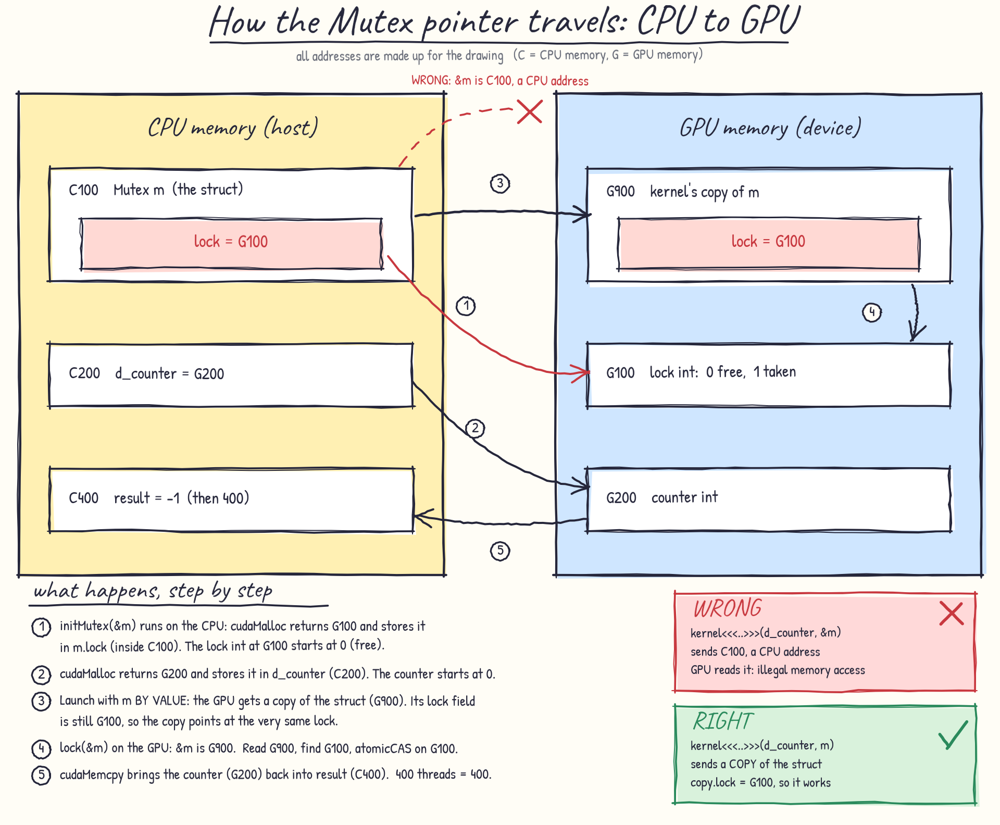

# 05 - Atomics and a hand-built mutex

Many threads updating the same memory location is where parallel code goes wrong. This folder
shows the bug, the built-in fix (`atomicAdd`), and then a mutex I built myself out of
`atomicCAS` and `atomicExch` to understand what an atomic really does.

> Examples are based on the [Infatoshi/cuda-course](https://github.com/Infatoshi/cuda-course/tree/master).
> The bugs and fixes below are ones I hit myself while running them on a Colab T4.

## Files

| File | What it does |
|---|---|
| `00_atomicAdd.cu` | 1,000,000 threads increment one counter, once without atomics and once with `atomicAdd` |
| `01_mutex.cu` | A spin-lock mutex protecting a counter (these versions contain the bugs described below) |

Run them:

```bash
nvcc -arch=sm_75 -lineinfo file.cu -o file
./file
compute-sanitizer ./file      # reports invalid memory accesses
```

## 1. The problem: a race condition

```cuda
int old = *counter;      // read
int new_val = old + 1;   // add
*counter = new_val;      // write
```

That is three steps. If two threads read the same `old` before either writes, both write
`old + 1` and one increment is lost. With 1,000,000 threads, most increments are lost, and the
result changes from run to run.

`atomicAdd(counter, 1)` does read, add and write as one indivisible step, so the answer is always
exactly 1,000,000.

| Kernel | Counter after 1000 blocks x 1000 threads |
|---|---|
| Non-atomic | _paste your output here (well below 1,000,000, differs per run)_ |
| `atomicAdd` | 1000000 |

## 2. `atomicCAS` (compare and swap)

```cuda
int atomicCAS(int* addr, int compare, int val);
// done as ONE indivisible step:
//   old = *addr;
//   if (old == compare) *addr = val;
//   return old;
```

`atomicCAS(lock, 0, 1)` means "if the lock is free (0), take it (set it to 1)". It returns 0 if I
got it, 1 if someone else already holds it. A mutex is a loop around that:

```cuda
__device__ void lock(Mutex *m)   { while (atomicCAS(m->lock, 0, 1) != 0) { } }   // spin until free
__device__ void unlock(Mutex *m) { atomicExch(m->lock, 0); }                      // set back to free
```

## 3. Where the pointers live

The Mutex struct sits in CPU memory, but the `int` it points to sits in GPU memory. Mixing those
up caused my first bug.



Addresses in the drawing are made up (C = CPU, G = GPU). The short version:

- `initMutex(&m)` runs on the CPU. `&m` (C100) is a valid CPU address there. `cudaMalloc` stores a
  GPU address (G100) inside `m.lock`.
- Passing `m` **by value** to the kernel copies the struct to the GPU (G900). The copy's `lock`
  field still holds G100, so every thread reaches the same lock int.
- Passing `&m` sends C100, a CPU address, and the GPU cannot read it.

## 4. Bugs I hit, and what each one taught me

| # | What I saw | Cause | Fix |
|---|---|---|---|
| 1 | `illegal memory access`, then a counter value that looked fine (1000, 600, 400) | Launched with `&m`, a host address. The copy back failed, so `result` kept leftover junk | Take `Mutex m` by value in the kernel and launch with `m` |
| 2 | `compute-sanitizer`: `Invalid __global__ read ... in lock(Mutex *)` at an address starting `0x7ffc...` | Confirmed bug 1: the GPU read a CPU stack address | Same fix |
| 3 | 2 blocks gave `601` instead of `1200`, with no error | Memory visibility between blocks: each SM can work with its own cached or not-yet-visible copy of the counter | `__threadfence()` after taking the lock and before releasing it, and `volatile` on the counter pointer. Result became `1200` |
| 4 | Launching 1200 threads in one block fails | A block holds at most 1024 threads | Split into 2 blocks of 600 |

### Why `__syncthreads()` is not a substitute for `__threadfence()`

- `__syncthreads()` is a **barrier** for one block. Inside the critical section only one thread
  runs, so the others never reach the barrier and the kernel hangs.
- `__threadfence()` is a **memory-ordering fence** for the whole GPU. It does not make threads wait.
  It guarantees my earlier writes become visible before my later ones.

## 5. Habits this taught me

- **Initialize the result to something impossible** (`int result = -1;`). A failed copy then shows
  up as `-1` instead of a plausible number.
- **Check errors after the launch and after `cudaDeviceSynchronize()`.** A crash inside a kernel is silent
  otherwise.
- **A correct-looking output is not proof.** My 400 was junk, and the code was wrong.
- **Run `compute-sanitizer`** when a result surprises you. It names the line and the bad address.
- **Test with more than one block.** Some concurrency bugs only appear across blocks.

## 6. What I would use in real code

For a counter, `atomicAdd`. It is one instruction, with no lock, no fence and no way to get the
ordering wrong. The mutex was for learning how locking works, and it has real limits:

- Threads queue up one at a time, so it is slow.
- A spin lock across many blocks can deadlock if the block holding the lock is not running while
  others spin.
- On GPUs older than Volta, threads in one warp run in lockstep and a spin lock inside a warp can hang.

