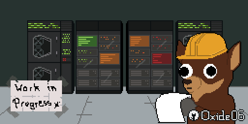

<p align="center">
  
</p>


# CUDA Learning Journal

My notes and experiments while learning CUDA and GPU programming. I started from C pointers and
have worked up through thread indexing, vector addition, matrix multiplication, atomics, and
streams. I'm still adding to it as I learn.

> **Credit:** my learning has been heavily based on
> [Infatoshi/cuda-course](https://github.com/Infatoshi/cuda-course/tree/master).
> The curriculum belongs to its author. This repo is my own practice, notes and experiments while
> following it. If you want to learn CUDA, start there.

## Attribution and Licensing

This repository documents my journey into CUDA and GPU programming.

The learning path is primarily inspired by
[Infatoshi's CUDA Course](https://github.com/Infatoshi/cuda-course).

Some implementations are based on or adapted from examples in
the course. Other experiments, explanations, visualizations, and
implementations represent my own work.

Third-party materials remain subject to their respective
copyright and licensing terms.

The MIT License applies only to my original contributions,
not to third-party materials.

## Contents

| Folder | What it covers |
|---|---|
| [`00_c_pointers`](00_c_pointers) | Pointer refresher in plain C: multi-level pointers, `void*`, `NULL` and `malloc`, pointer arithmetic, `sizeof` and `size_t` |
| [`01_hello_cuda`](01_hello_cuda) | The first kernel: `hello<<<2, 4>>>()` |
| [`02_thread_indexing`](02_thread_indexing) | Flattening 3D `blockIdx` / `threadIdx` into one global id, and why 64 threads per block means 2 warps |
| [`03_vector_add`](03_vector_add) | CPU vs GPU vector addition on 10M floats, with a correctness check |
| [`04_matrix_multiplication`](04_matrix_multiplication) | Basic matrix multiplication on the GPU, using a 2D grid and 2D blocks |
| [`05_atomics`](05_atomics) | Race conditions, `atomicAdd`, and a mutex built from `atomicCAS`, with the bugs I hit along the way |
| [`06_streams`](06_streams) | Streams, async copies, pinned memory, and synchronization (in progress) |
| [`visualizations`](visualizations) | Interactive HTML page: a CPU `for` loop vs a kernel launch |
| [`notebooks`](notebooks) | The Colab notebook these files came from |

## Setup

- GPU: Tesla T4 (Google Colab free tier), compute capability 7.5 (`sm_75`)
- CUDA toolkit: 13.0 (check yours with `nvcc --version`)
- No GPU of your own? Open the notebook in Colab and pick **Runtime > Change runtime type > T4 GPU**.

Compile and run any CUDA file:

```bash
nvcc -arch=sm_75 -O2 file.cu -o file
./file
```

Check a program for invalid memory accesses:

```bash
nvcc -arch=sm_75 -lineinfo file.cu -o file
compute-sanitizer ./file
```

Compile and run any C file:

```bash
gcc file.c -o file && ./file
```

## Key takeaways

1. **There is no loop in a kernel.** The launch line starts all the threads, and each one computes
   its own global id from `blockIdx` and `threadIdx`.
2. **3D indexing is just row-major flattening**, once for the block in the grid and once for the
   thread in the block.
3. **Warps are 32 threads**, cut from the flat thread id. A block of 64 threads is 2 warps.
4. **Output order from parallel threads is not guaranteed.** Warps start in whatever order the
   scheduler picks.
5. **Benchmark carefully.** Launches are asynchronous, so synchronize before stopping the timer.
6. **Many threads writing one value is a race.** `atomicAdd` fixes it. A hand-built mutex needs
   fences (`__threadfence()`) to work across blocks.
7. **A kernel can only use GPU memory.** Passing the address of a CPU struct to a kernel crashes.
   Pass the struct by value instead.
8. **A stream is an in-order queue of GPU work.** Different streams can overlap, but if one
   depends on another, I have to synchronize it myself.
9. **A correct-looking output is not proof.** A failed copy can leave an uninitialized variable
   that happens to look right.

## Testing checklist

Things I check before trusting a result:

- [ ] Compiles with no warnings
- [ ] The GPU result matches the CPU result (tolerance, not exact equality, for floats)
- [ ] The kernel has a bounds check (`if (i < n)`) when the thread count is rounded up
- [ ] A warmup run happens before timing
- [ ] `cudaDeviceSynchronize()` is called before the end timestamp
- [ ] CUDA calls are checked for errors (`CHECK_CUDA_ERROR` macro)
- [ ] Result variables start at an impossible value (like `-1`), so a failed copy shows
- [ ] Concurrent code is tested with more than one block
- [ ] `compute-sanitizer` reports 0 errors
- [ ] Timings are averaged over several runs and the GPU model is written down

## Results so far

See [`03_vector_add`](03_vector_add) for the numbers and what they do and do not mean.

See [`04_matrix_multiplication`](04_matrix_multiplication) for the numbers, and for why the CPU and GPU results can differ in the last few digits.

See [`05_atomics`](05_atomics) for the bugs I hit with a mutex and what each one taught me.

## Next

- [ ] Streams: a chunked version, timed against a single stream
- [ ] Reduction (sum) with shared memory and warp shuffles
- [ ] Tiled matrix multiplication with shared memory
- [ ] Profile with Nsight Systems